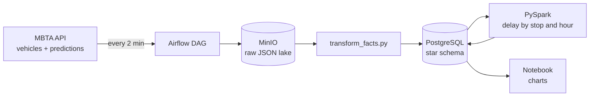

# MBTA Transit Data Platform

An end-to-end data pipeline that collects live Boston Red Line data, stores it, and measures how late trains run.

## Architecture



## What it does

1. **Ingest** – every 2 minutes, `fetch_once.py` saves raw vehicle and prediction snapshots to MinIO untouched.
2. **Load** – `transform_facts.py` reads only files not yet processed (tracked in `processed_files`) and inserts them into a Postgres star schema.
3. **Analyse** – a delay is the first time a train was seen stopped at a stop, minus the first arrival prediction made for it. `spark_jobs/delay_analysis.py` aggregates this by stop and hour and writes `fact_delay_summary`.
4. **Show** – `notebooks/delay_analysis.ipynb` charts the results.

Airflow (Docker, CeleryExecutor) runs steps 1–2 on a schedule with retries, one run at a time.

## Data model

Dimensions: `dim_routes`, `dim_stops`, `dim_trips`. Facts: `fact_vehicle_positions`, `fact_predictions`. Unique constraints make reloads safe (no duplicates).

## Run it

```bash
docker compose up -d                         # Postgres + MinIO
python ingestion/load_dimensions.py          # routes, stops, trips
cd airflow && docker compose up -d           # Airflow UI on :8080
python spark_jobs/delay_analysis.py          # needs Java 17
```
Copy secrets into `.env` (never commit it): MBTA API key, Postgres and MinIO credentials.

## Problems found and solved

- Shuttle-bus trips broke a foreign key → only Red Line trips are loaded.
- Child stop IDs missing from the stops list → stub dimension rows are created on demand.
- MBTA reuses `trip_id` across days, which produced ~24 h fake delays → service date is part of every key.
- Re-reading every file each run was too slow → incremental loading with `processed_files`.

## Limitations 

- Snapshots every 2 min can overstate delays by up to ~2 min.
- The first prediction is a proxy for the timetable, not the official schedule.
- Data exists only while the pipeline was running; groups per stop/hour are still small.
- One corrupt raw file would currently block later files.
- Red Line only. Everything runs locally; no cloud deployment, tests or CI yet.

## Roadmap

Tests and freshness checks, failed-file handling, more routes, then an AWS deployment (S3, a managed warehouse, scheduled orchestration).